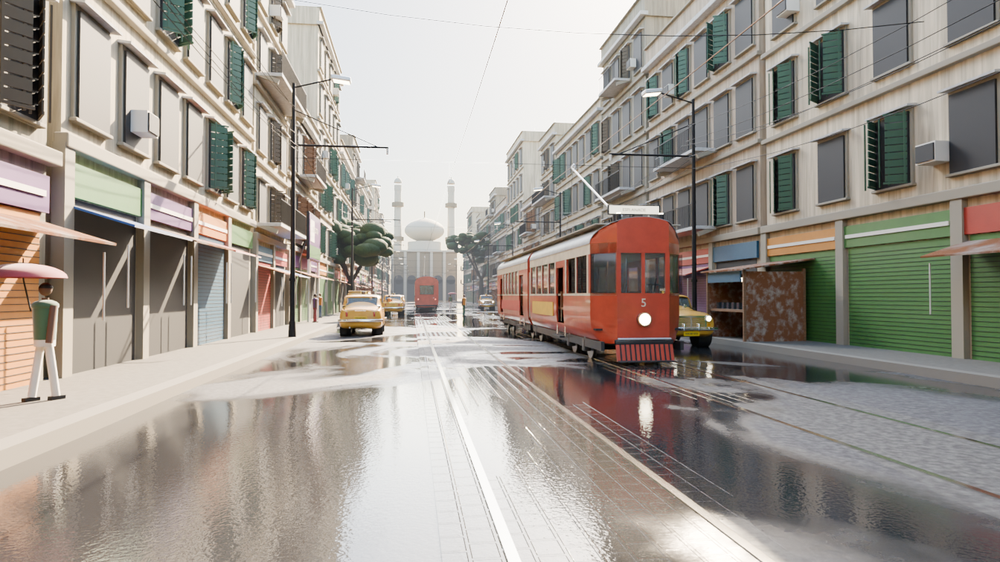
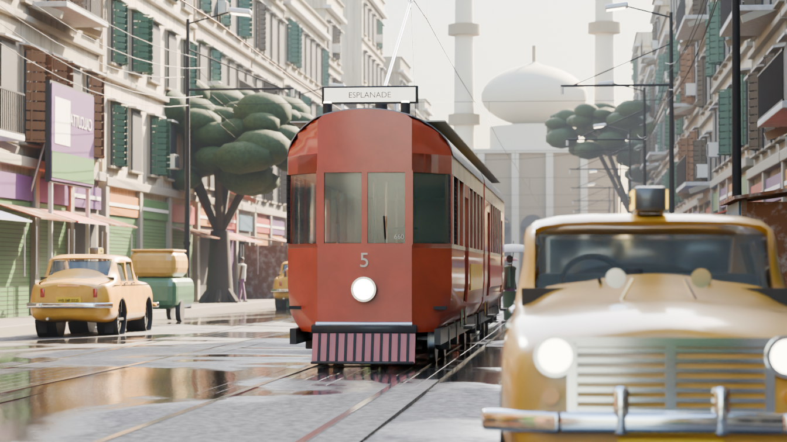
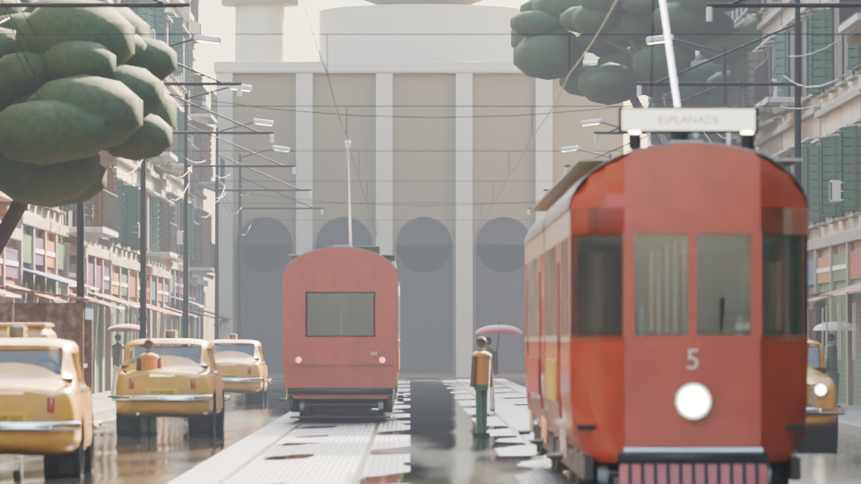
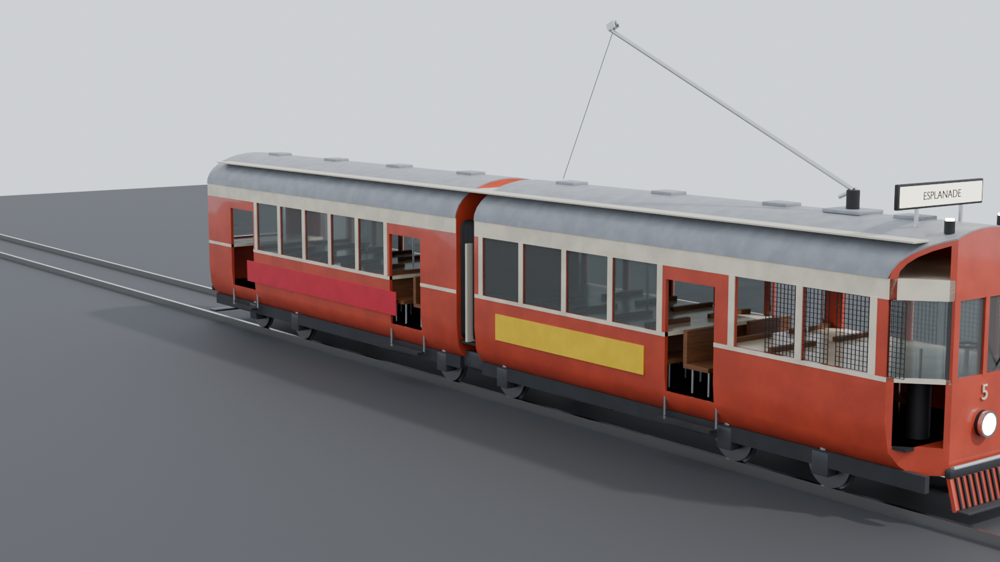
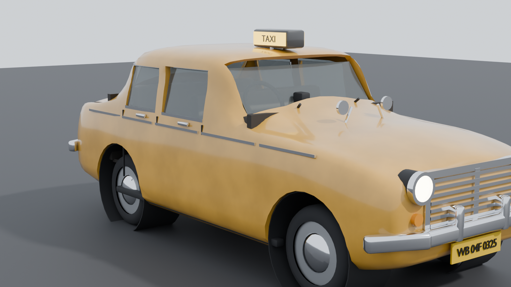

# Kolkata Street

A realistic Kolkata street scene, built to be looked at from anywhere in it. The
subject is a Calcutta Tramways articulated tram and a yellow Ambassador taxi, in
a north-Kolkata terrace street under monsoon light, with ten set-up cameras and a
dolly rig so the same street gives a different picture every time you move.

Built with Blender 4.2 LTS, headless, from Python. There are no image textures
and no downloaded assets: every material is procedural, so the `.blend` files are
self-contained and open the same on any machine.



*`SHOT_02_wet_wide` — 24 mm, standing in the road.*

## Layout

```
kolkata_street/
  build/
    klib/            shared library: mesh, mat, sceneutil, cam
    build_tram.py            -> assets/tram_ctc.blend
    build_ambassador.py      -> assets/ambassador_taxi.blend
    build_city_kit.py        -> assets/city_kit.blend
    build_street.py          -> scene/kolkata_street.blend
    render.py                render shots from the saved scene
    make_all.sh              build everything, in order
  assets/           the models, one file each
  scene/            the assembly
  renders/          output
  refs/             the reference images this was built against
```

**Each model is built once and lives in one file.** `build_street.py` does not
copy them, it *library-links* them and places collection instances, so all the
trams in the street are the same tram. Re-run `build_tram.py`, save, reopen the
street, and every tram in it has changed. Pass `--append` to the street build if
you would rather have a single self-contained scene file.

## Building

```bash
./build/make_all.sh                 # everything; about a minute, no rendering
./build/make_all.sh --preview       # ... and render every preview sheet as well
BLENDER=/Applications/Blender.app/Contents/MacOS/Blender ./build/make_all.sh
```

The geometry build is fast. `--preview` is not: it renders seven tram views, six
taxi views and all ten street shots in Cycles. Add `--samples 32` to make that
a quick look, or leave `--preview` off and render what you want afterwards with
`build/render.py --draft`.

or one at a time:

```bash
blender -b -P build/build_tram.py -- --preview
blender -b -P build/build_ambassador.py -- --preview
blender -b -P build/build_city_kit.py
blender -b -P build/build_street.py
```

Progress goes to `build/*.log`. Blender block-buffers stdout when it is
redirected, so on a long run the log file is the only way to watch it.

## Cameras — the point of the exercise

Ten cameras are set up in the street, each with a real focal length, aperture and
focus distance. `aim` in the `SHOTS` table at the bottom of `build_street.py` is a
*point in the street*, not a rotation, so you can move a camera by editing two
numbers.

| Camera | Lens | What it is |
|---|---|---|
| `SHOT_01_tram_nose` | 85 mm f/2.8 | Low and long, tram filling the frame |
| `SHOT_02_wet_wide` | 24 mm f/5.6 | Standing in the road, the whole wet street |
| `SHOT_03_telephoto_vista` | 200 mm f/4 | Compressed down the street, dome closing it |
| `SHOT_04_puddle` | 35 mm f/4 | 220 mm above the road; the reflection is the subject |
| `SHOT_05_balcony` | 50 mm f/6.3 | Second floor, looking down into the traffic |
| `SHOT_06_pavement` | 35 mm f/3.5 | Eye level on the footpath, under the awnings |
| `SHOT_07_under_wires` | 28 mm f/8 | Up among the trolley wire, looking down the line |
| `SHOT_08_taxi_three_quarter` | 50 mm f/2.2 | Taxi close, tram soft behind it |
| `SHOT_09_crossing` | 50 mm f/4 | From the far kerb, back across both tracks |
| `SHOT_10_tram_rear` | 70 mm f/4 | Behind and above the near tram |

Plus `CAM_DOLLY`: a camera on a NURBS path up the middle of the street, aimed at
an empty called `CAM_DOLLY_TARGET`. Scrub frames 1–250 to move the shot; drag the
target to re-aim it. That is the knob to turn when the fixed shots do not give
you the perspective you want.

```bash
blender -b scene/kolkata_street.blend -P build/render.py -- --list
blender -b scene/kolkata_street.blend -P build/render.py -- --all --draft
blender -b scene/kolkata_street.blend -P build/render.py -- --shot SHOT_03_telephoto_vista --samples 256
blender -b scene/kolkata_street.blend -P build/render.py -- --dolly 1,60,120,180,250
```

`--draft` is 32 samples at half resolution — use it while you are moving cameras.

## The tram

The classic Calcutta Tramways articulated six-axle single-deck car: the type
Nonapukur, Burn Standard and Jessop built, and the type in all four reference
images. It is built to these checked facts, which are restated at the top of
`build_tram.py` next to the numbers they drive:

| | |
|---|---|
| Gauge | **1,435 mm standard gauge.** The system started metre gauge and was converted from 1900. It is *not* broad gauge — that is the Indian main line |
| Length / width / weight | 57 ft = **17.37 m**, 7 ft = **2.134 m**, 18 t (preserved car No. 204, Heritage Transport Museum) |
| Power | 550 V DC overhead, rails as the return |
| Collector | **Trolley pole**, on the leading coach — not a pantograph |
| Ends | **Single ended**; routes turn on terminal loops, so there is a cab at one end only |
| Bodies | Two, permanently articulated, on **three two-axle trucks** — one under each outer end and a shared truck under the joint. That is what "six-axle articulated" means |
| Classes | First class leads, second class trails, with a partition |
| Motorman | Screened by coarse **weldmesh**, not glass |
| Seating | 54–61, depending on which source you believe |

The build reports its own envelope, so a change that breaks the dimensions is
visible in the log:

```
tram bounds  L=18.025 (body 17.370)  W=2.354 (body 2.134)  H=5.774 incl. pole
tris=25148  materials=18
```

The body is 17.37 m; the lifeguard trays add about 0.33 m at each end, the
footboards 0.11 m each side, and the height is to the trolley wheel in running
position, which is where the wire is.

Window heights, pillar widths, the roof radius and the truck wheelbase are not
published anywhere I could find. They are read off the reference photographs
against the known width and length, and they are all in the `SPEC` dict at the
top of the file so they are easy to argue with.

The cab front — the faceted bay, the three-pane windscreen, the route number
painted large on the dash, one big round headlight below it, the destination
board on brackets above the roof, marker lamps at the roof corners — follows the
"Old Tram" reference. The Kolkata-specific parts are the weldmesh, the slatted
lifeguard gate and apron at the rail, the trolley pole and the CTC livery.

**Livery** is a dict at the top of the file. Change `LIVERY['body']` and rebuild.
Route number, destination and fleet number are `SPEC['ROUTE']`, `SPEC['DEST']`,
`SPEC['FLEET']`.

## The taxi

Hindustan Ambassador Mark IV / Classic — the Morris Oxford Series III body
Hindustan kept building at Uttarpara until 2014.

| | published | built |
|---|---|---|
| Length | 4,325 mm | 4,329 over bumpers (body alone 4,149) |
| Width | 1,662 mm | 1,676 over the body, 1,801 over the mirrors |
| Height | 1,600 mm | 1,603 roof above the road, 1,804 over the TAXI box |
| Wheelbase | 2,464 mm | 2,464 |
| Ground clearance | 155 mm | 155 |

Sources differ by a millimetre or two on width and height; the figures used are
in `SPEC`.

The body is **not** boxes. It is a loft through fourteen cross-sections, each a
closed Catmull-Rom curve through seven landmarks — underside, widest point,
beltline, tumblehome, roof side, crown. That is what produces the bulbous Morris
shoulder and the domed roof. The sections are mirrored *before* splining, so the
roof crown and the underside stay smooth across the centre line instead of
creasing.

The body is then hollowed with an inset copy of the same loft, and only then are
the wheel arches, side windows and the two raked screens cut. Order matters: a
window cutter driven into a solid body only buries a void inside it, the surface
never opens, and every boolean after that misbehaves.

Trim — waist moulding, door shut lines, handles, window surrounds, mirrors — is
placed with `hw_at(x, z)`, which walks the section landmarks and returns the
body's half-width at that point. The flank tumbles in about 150 mm above the
beltline, so trim at a constant `y` either floats in the air or vanishes inside
the car.

Right-hand drive, because India drives on the left. Taxi fittings: all-over
yellow, roof `TAXI` box, black-on-yellow commercial plates (`SPEC['PLATE']`),
meter on the dash, mudflaps.

## The street

Everything else is `build_city_kit.py`, and the buildings in it are a *generator*,
not a model. A north-Kolkata terrace is a rhythm: a shop at the bottom, three or
four storeys of tall louvred-shutter windows, a projecting sun hood (chhajja) over
each, cast-iron balconies, a string course at every floor, a parapet, water tanks
on the roof — all under lime plaster the monsoon has streaked black. `building()`
takes a width, a floor count and a seed and plays that rhythm back differently
each time; six of them are baked into the kit and the street cycles through them.

The kit also holds the traction poles, the tin-roofed stall, the hoarding, two
trees, a handcart, an auto-rickshaw, six walk-on figures, and the domed mosque
that closes the view down the street.

`build_street.py` builds only the ground the rest stands on:

- **Carriageway** — a real grid mesh with a camber, hollows worn along the rails,
  a dish of standing water at the kerb, and low noise, so the puddles in the
  material have somewhere to sit.
- **Track** — two tracks of 1,435 mm grooved rail laid flush in a band of granite
  setts, kerbs and footpaths. Traffic keeps left, so the +X-bound track and the
  +X-bound traffic are both on the +Y side.
- **Overhead** — traction poles every 23 m, the 550 V trolley wire over each
  track, span wires, and the thicket of telecom and power cable that is half of
  what a Kolkata street actually looks like. Every wire sags.
- **Weather** — a hazy overcast sky, a big soft sun, and depth haze from the
  **mist pass in the compositor**, not a world volume. A world volume in Cycles
  is unbounded, so light from a sun — which is infinitely far away — is
  extinguished over an infinite path and the whole scene renders black. The mist
  pass gives the same aerial perspective for nothing, with no volume noise, and
  `add_mist_haze(start, depth, colour, strength)` can be re-dialled in the
  compositor without re-rendering.

`wet_asphalt` is the most important material in the scene and the one worth
tuning first. Dry asphalt is near-black and rough; where a puddle sits, roughness
collapses to a mirror and the surface darkens. `ST['WET']` runs 0 (dry) to 1
(sheet water). That contrast is what makes the references read as monsoon
Kolkata.

The track band uses **the same material**, with the sett joints as bump only.
That is not laziness. At grazing incidence — which is what a camera 1.6 m above
a road sees at fifty metres — Fresnel reflectance goes to 1 whatever the base
colour, so a separate, slightly glossier stone material turns the whole track
into a sheet of white sky and reads as a pavement running down the middle of the
carriageway. Same wetness, same puddles, joints in the bump, and then the rails
are the only bright lines — which is what the photographs show.

All of it is driven from **world-space** coordinates (the Geometry node's
Position), not Generated. Generated is normalised to each object's own bounding
box, so the road and the track band — two different objects — would otherwise
get two unrelated puddle fields meeting along a hard edge.

## Things that bit, and are fixed

Worth knowing if you extend this, because they are all silent failures:

- **A world volume blacks out the scene.** It is unbounded, so the sun's light is
  extinguished over an infinite path. Haze is a mist pass instead.
- **`wm.link` also puts the linked collection in the scene**, so every asset
  renders once at its authored position *and* once per instance — a heap of
  trams and buildings in a pile at the origin. `link_collection` drops the source
  collection out of the hierarchy afterwards; the instances keep working.
- **An inward-facing solid inverts every boolean after it.** `recalc_face_normals`
  only makes normals *consistent*; on a lofted tube with n-gon caps it can settle
  on the inward solution, and then a DIFFERENCE eats the model instead of the
  cutter. `recalc_normals` checks the signed volume and flips.
- **A window cutter in a solid body only buries a void inside it.** Hollow first,
  then cut. The vehicle builds log `closed=` at every stage so this is visible.
- **Chamfering a hollow shell does not make a facet**, it slices the shell open
  and the cavity shows through the gap. The tram's cab chamfer is built into the
  loft instead.
- **Generated texture coordinates are per-object.** Two neighbouring surfaces
  sharing a material get unrelated patterns. Anything that has to be continuous
  across objects — the wet road — uses world-space Position.
- **Principled sheen is a white rim lobe.** On the big smooth spheres a
  procedural canopy is made of it covers the whole surface, and every tree
  renders as a pale grey blob. Foliage uses no sheen.
- **Joining takes the first part's object transform.** If that part is not at the
  origin, the asset's local space is rotated and offset from world space. Both
  vehicle builds apply the transform after joining.

## Axes

`+X` is forward for both vehicles and is the street's long axis. `+Z` is up.
`+Y` is each vehicle's **left**. The tram's origin is on the **rail head**; the
taxi's is on the **road**. Both have their transforms applied, so local space is
world space.

## What this is not

- The figures are stylised on purpose. At the distances they are used, a correct
  silhouette and a block of sari or shirt colour do more than a detailed mesh,
  and they stay cheap enough to scatter by the dozen. They are not people.
- Signage is painted panels, not Bengali text. Blender's bundled font has no
  Bengali glyphs, so the only real text in the scene is Latin and digits: route
  numbers, the destination board, the number plates.
- The interiors are furnished enough to read through glass and no further.
- Nothing is animated except the dolly camera. The trams and taxis are placed,
  not driven.

## Gallery

`gallery/` holds the few images the README shows. `renders/` is build output and
is not in version control — run `build/render.py` and it fills up again.

| | |
|---|---|
|  |  |
| `SHOT_01_tram_nose`, 85 mm | `SHOT_03_telephoto_vista`, 200 mm |
|  |  |
| the tram, three-quarter | the taxi, three-quarter |

## References

In `refs/`. Two watercolours and an oil of a Kolkata tram in the wet, a telephoto
of yellow Ambassador taxis on Rabindra Sarani with the Nakhoda Masjid behind, and
the "Old Tram" model that the cab front follows.

## Sources

- [Trams in Kolkata](https://en.wikipedia.org/wiki/Trams_in_Kolkata) — gauge, 550 V DC, trolley pole, the articulated classes
- [Calcutta Tramways Company](https://en.wikipedia.org/wiki/Calcutta_Tramways_Company)
- [Heritage Transport Museum tram gallery](https://heritagetransportmuseum.org/collection/tram-gallery) — car No. 204, 57 ft × 7 ft, 18 t, 61 seats
- [Around the World in Trams: Kolkata 191](https://www.britishtramsonline.co.uk/news/?p=53311) — single-ended, terminal loops
- [CTC: about](https://www.calcuttatramways.com/about-ctc/) — two compartments, seating
- [Ambassador specifications](https://www.cardekho.com/overview/Ambassador/Ambassador_Classic_Nova_Petrol.htm) — dimensions
- ["Old Tram" by FOXYSCA](https://sketchfab.com/3d-models/old-tram-9d8bdac6310a46ef9cc2aaf0f9c9768a) — the cab front reference

## Run it in the browser (WebXR)

**The primary deployment is Aritra's portfolio:**

> **https://pixeljoy1.github.io/aritra-portfolio/kolkataStreetXR/**

That is where this project is meant to be seen. Build the deploy folder and copy
it across:

```bash
./build/make_web.sh                 # -> dist/kolkataStreetXR/   (8.6 MB, 28 files)
cp -R dist/kolkataStreetXR <aritra-portfolio>/kolkataStreetXR
```

`make_web.sh` re-exports from Blender, so it is the one command to run after any
change to the models or the street. It writes **self-contained glTF JSON** by
default, because that is what the portfolio serves; pass `--glb` for the smaller
binary form if the host handles `model/gltf-binary`.

`docs/kolkata/` holds the same page for local work and as a second copy on this
repo's own Pages site:

```bash
cd docs && python3 -m http.server 4210
# then open http://localhost:4210/kolkata/
```

WebXR needs HTTPS, which Pages provides; `localhost` is also treated as a secure
context, so the desktop view works locally without a certificate.

### Movement

Movement is **`xr-locomotion.js`, used unmodified** — the standalone module from
`XR_Locomotion/locomotion/`, v1.13 behaviour out of keralamHouseXR. It is
vendored at `docs/kolkata/xr-locomotion.js`; its own guide and the design spec
are in `refs/`. Do not fork it: fix it upstream and re-copy.

The module owns the player. It builds the rig, the camera, both Touch
controllers, the black fade, the mode text, the fly readout and the reset
dialog, so **this page adds no camera and no controllers of its own**:

```html
<a-scene xr-locomotion="world: #world; start: -25 0 4.6; bounds: 160 44; ceiling: 34">
```

| | |
|---|---|
| **Quest** | Right stick walk and turn. Right trigger walks where the hand points, harder is faster. Left stick forward teleports. **A** walk/fly, **B** or **Y** reset dialog, **X** next viewpoint. Flying: right trigger glides, left trigger or right stick back reverses, tilt the right hand while a trigger is held to climb or dive, left stick for height, wrist steers. |
| **Desktop** | `Space` trigger, `WASD` stick, `Shift` reverse, `E`/`Q` up and down, `F` walk/fly, `R` reset, `Esc` close. Plus this page's own: `1`…`0` viewpoints, `V` next, `T` hold the traffic, `L` shadows, `I` input monitor. |

### Meeting the module's world contract

The module's contract is that every mesh under `world` is collision geometry,
`WALK_*` is standable and everything else blocks. The visible city **cannot**
meet that contract: it is drawn with `InstancedMesh`, so forty-five buildings
share one geometry across a handful of batches, and the per-mesh world box the
module caches to cull its raycasts does not exist for any single building.

So the scene is split:

- **`#world`** — the ground GLB (`WALK_road`, `WALK_footpath`,
  `WALK_far_ground` are standable; `SOLID_track` blocks) plus **one invisible
  proxy box per placement**, 117 of them, sized from that model's own bounds as
  it loads. The footprint is taken from the geometry **below 2.2 m** and run up
  to the model's full height, so you walk under a tree's canopy and are stopped
  by its trunk, and under a hoarding but not through its legs.
- **`#city`** — everything you see, outside the collision world.

`street.js` calls `collect()` on the module once the city is placed, because
everything arrives after the module has loaded.

### The traffic moves

The street drives itself, which is most of what makes it feel like a street
rather than a model of one. `SPEED` at the top of the traffic section of
`street.js`:

| | m/s | |
|---|---|---|
| Tram | 3.0 | about 11 km/h — a Kolkata tram trudges, and looks it |
| Taxi | 7.2 | about 26 km/h |
| Auto-rickshaw | 5.6 | about 20 km/h |

Nothing is re-placed: `layout.json` stays the source of truth and only a
distance along each vehicle's own heading is animated, wrapping round the length
of the street. The two trams are clones and move directly; the taxis and autos
are instanced, so their instance matrices are rewritten each frame — eight
vehicles across thirteen sub-meshes is a few hundred matrix writes, which costs
nothing next to drawing them.

Each vehicle's **collision proxy is carried along with it**, and its cached
world box refreshed, because the locomotion module culls its raycasts against
that box: a stale one means you get stopped by where the taxi used to be. `T`
holds the traffic.

### Day, night and the wet road

A control panel, top right: **Night**, **Wet road**, **Traffic**, **Shadows**.
Keys `N`, `G`, `T`, `L`. In a headset there is no keyboard, so the two scene
settings are on the thumbstick clicks — **right stick click** for night, **left
stick click** for the wet road — which are the only buttons `xr-locomotion`
leaves free.

**The reflections are baked from the city, not from a gradient.** The page
starts with a vertical gradient environment map so metal is not black, and then,
once everything is placed, renders one cube from the middle of the street at
3.2 m and runs it through `PMREMGenerator`. After that the wet road and the
chrome reflect actual buildings, trams and taxis, which is what makes the
monsoon look read. It costs six renders once, nothing per frame, and it is
re-baked when the light changes.

Night drives four things at once: the sky, fog and lights; the lamp materials
(`city_lamp`, `amb_lamp`, tram lamps, the TAXI sign) back up to the emissive
strength they were authored with in Blender; the shop interiors; and the
building windows, which get a warm emissive they do not have by day.

Each building GLB carries its own copy of `city_glass`, so the window brightness
is varied by a hash per material and the terrace lights unevenly rather than
every window coming on at once. That only works because `export_web.py`
deliberately **excludes glazing from the material merge** — merging it saves
nothing, since glass only ever merges with other glass and those live in
different asset files, but it would cost the page its per-building window
material.

### When a behaviour does not work on the headset

The Quest browser has no console, so press **`I`** (or add `?diag=1`) for a live
input monitor. It reports both what the module sees and what the raw WebXR
gamepads report:

```
vr      yes          mode    walk
trigger R 0.62  L 0.00        stick R 0.00 -0.80  L 0.00
floors  4    solid 121        rig  -25.0 0.1 7.6
sources 2
  left  ax 0.0,0.0,0.0,-0.8   bt 0v000
  right ax 0.0,0.0,0.6,0.0    bt v0001
```

**The most likely cause, and what is done about it.** `xr-locomotion` binds
A-Frame's `oculus-touch-controls`, which matches the WebXR profiles
`oculus-touch`, `-v2` and `-v3`. A Quest 3 reports its controllers as
`meta-quest-touch-plus`, which that component does **not** match — so it never
binds, no events are emitted, and every control is dead while the scene renders
perfectly. That is exactly the "launches fine, nothing works" symptom.

Rather than fork the module, `quest-input` reads the raw WebXR gamepads every
frame and writes the same fields the module's own handlers would. Analog values
are plain assignment, so if the A-Frame component does bind on some other
headset the two agree; buttons are edge-detected and suppressed the moment a
native A-Frame button event is seen, so nothing fires twice. On entering VR the
page prints which profiles the controllers actually reported.

The monitor still distinguishes the three failures that look identical from
inside a headset:
**`sources 0`** means WebXR is not handing over the controllers at all;
**gamepad axes moving while `stick` stays 0** means the controller component is
not emitting events, in which case try adding `meta-touch-controls` beside
`oculus-touch-controls` on the module's hands; **both moving while nothing
happens** means the module is reading input but something downstream is wrong —
check `floors`, because zero standable meshes means you have nothing to walk on.

### Hosting it somewhere that only serves known file types

Some hosts serve only a fixed set of extensions, and `.glb` is often not one of
them. `build/glb_to_json.py` rewrites each model as self-contained glTF JSON,
with the binary buffer inlined as a base64 data URI:

```bash
python3 build/glb_to_json.py ../docs/kolkata/models /tmp/web/models
```

Base64 costs about a third more bytes (6.7 MB becomes 8.8 MB) and
`THREE.GLTFLoader` parses it without caring what the file is called, because it
sniffs the content rather than the name. Set `"asset_ext": ".json"` in that
copy's `layout.json` and `street.js` picks it up; the repo keeps its `.glb`
files and both copies stay one codebase.

A-Frame is loaded from `cdn.jsdelivr.net` rather than `aframe.io` for the same
reason — some hosts allow scripts only from a short list of CDNs.

Three things are deliberately not carried over to the web build:

- **Procedural materials.** glTF cannot hold them, so `export_web.py` walks each
  node tree to a representative flat colour. Detail is lost; colour is not. The
  wet carriageway is restored in the page instead — near-black, low roughness,
  against a gradient environment map, which is the same Fresnel-at-a-grazing-
  angle effect that does the work in Cycles.
- **Glass.** glTF transmission is patchy across viewers, so glazing becomes a
  dark, mostly-opaque pane. It reads correctly at street scale.
- **Shadows in VR.** The shadow pass is dropped on entering immersive mode and
  restored on exit (`L` toggles it by hand).
